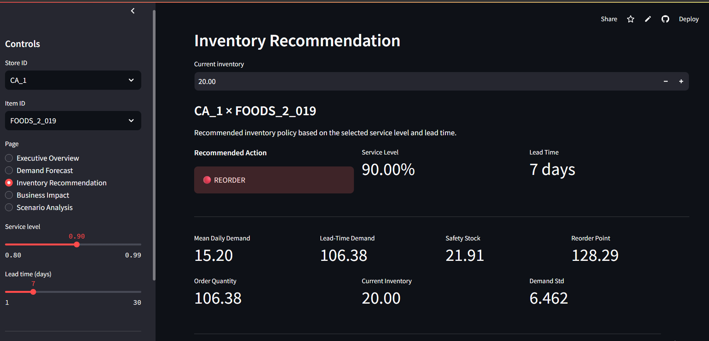
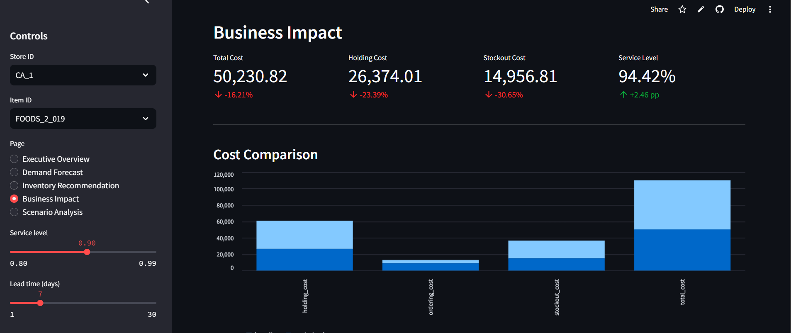
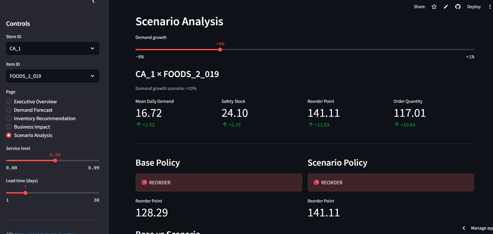
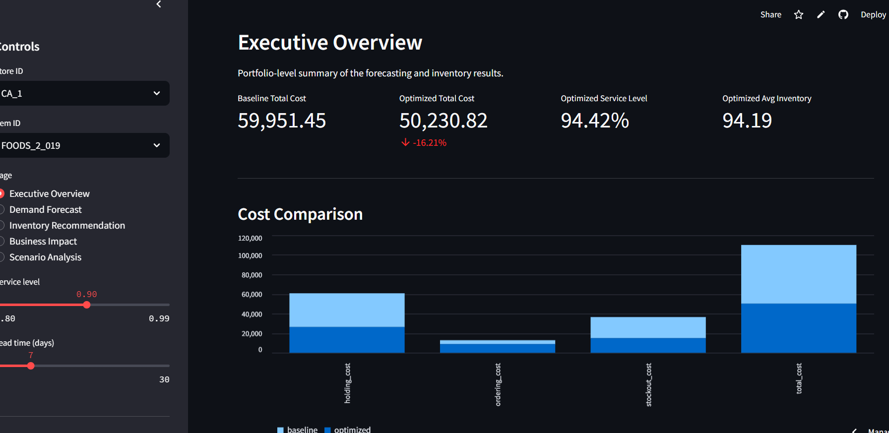
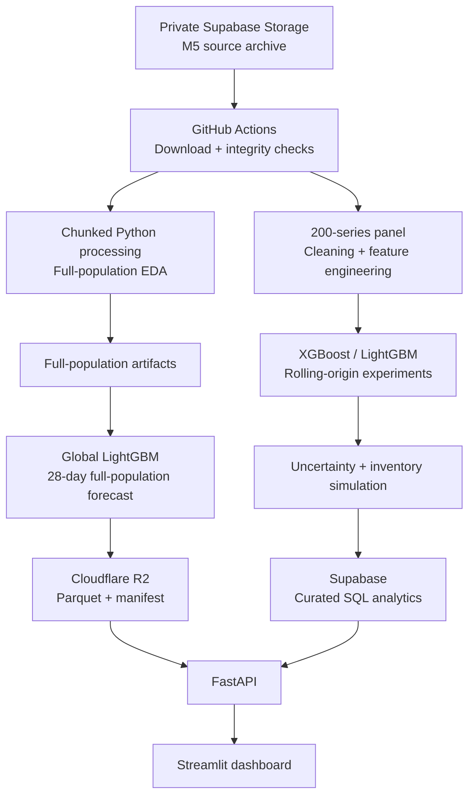

# Retail Demand & Inventory Optimization

An end-to-end retail decision-intelligence portfolio project built on the **M5 Forecasting — Accuracy** dataset. It combines large-scale demand analytics, time-series feature engineering, global machine-learning forecasts, uncertainty diagnostics, replenishment policies, and an interactive dashboard.

<p align="left">
  <a href="https://retail-demand-inventory-optimization-v1.streamlit.app/"><strong>Open Streamlit Dashboard</strong></a> ·
  <a href="https://retail-demand-inventory-optimization.onrender.com/docs"><strong>FastAPI Docs</strong></a> ·
  <a href="https://github.com/Harshithpatali/retail-demand-inventory-optimization/actions"><strong>GitHub Actions</strong></a>
</p>

> **Scope note:** this repository contains two distinct modelling tracks. Full-population EDA and a 28-day global LightGBM forecast cover all 30,490 item-store series. The more extensive rolling-origin model comparison, conformal interval evaluation and inventory-policy simulation use a separate, selected 200-series panel. Results from these tracks are not interchangeable.

## 2-minute project walkthrough

**The business problem.** Retailers must decide how much stock to hold before future demand is known. Under-forecasting can increase stockouts; over-forecasting ties up working capital. The problem is harder for products that sell intermittently, where long runs of zero-sales days are mixed with occasional demand spikes.

**What I built.** I used the M5 Walmart dataset to create a reproducible data pipeline, profile the complete assortment, engineer lag/calendar/intermittency features, train and compare forecasting models, and translate predictions into periodic-review replenishment decisions. Data processing is automated with GitHub Actions; Parquet artifacts are stored in Cloudflare R2; curated SQL analytics are published to Supabase; FastAPI serves analytics and decision endpoints; Streamlit provides the user-facing workspaces.

**What the evidence says.** On the full 30,490-series population, the selected 75%-sample LightGBM model achieved **72.50% test WAPE**, versus **86.27%** for the seasonal-naive baseline. That is a **15.95% relative reduction in WAPE**, but the remaining error is high and the model still under-forecasts aggregate demand by about **4.81%**. Separately, on the selected 200-series rolling-origin benchmark, XGBoost achieved **29.11% WAPE**. In a 200-series held-out inventory simulation, the forecast-driven policy reduced simulated cost by **17.62%** under configured assumptions. These are historical benchmark and simulated results—not live retailer savings.

**How to explore it.** Open the dashboard, start with Full Population Forecast to inspect the 30,490-series experiment, then inspect Demand Forecast and Inventory Control for the separate 200-series modelling workflow. The screenshots below provide a quick visual preview.

## At a glance

| Dimension | Evidence |
|---|---|
| Full M5 population | 30,490 item-store series × 1,941 daily observations |
| Historical period | 2011-01-30 to 2016-05-23 |
| Full-population future output | 28 days × 30,490 series = 853,720 forecast rows |
| Full-population training design | Nested 25%, 50%, 75%, 100% series samples; 75% selected on validation heuristic |
| Separate modelling panel | 200 selected item-store series; 388,200 daily panel rows |
| Forecasting methods | LightGBM, XGBoost, naive, seasonal naive, moving average, Croston SBA |
| Decision layer | Periodic-review replenishment and cost/service simulation |
| Application | FastAPI + Streamlit |
| Data and automation | Cloudflare R2, Supabase, GitHub Actions |

## Screenshots

The images are committed in `docs/screenshots/`.

<p align="center">
  
  <br><em>Application overview</em>
</p>
<p align="center">
  
  <br><em>Analytics workspace</em>
</p>
<p align="center">
  
  <br><em>Forecasting and decision workspace</em>
</p>
<p align="center">
  
  <br><em>Inventory and scenario workspace</em>
</p>

## Problem framing

Demand varies by product, store, weekday, season, event and price. A useful system must do more than output a point forecast: it should expose forecast error, distinguish smooth from intermittent demand, and show how different replenishment choices affect availability and inventory cost.

The project investigates this decision chain:

1. Profile the full historical population.
2. Build time-aware features without using future demand as an input.
3. Compare machine-learning forecasts with transparent baselines.
4. Evaluate on chronological validation and test windows.
5. Diagnose residual uncertainty and empirical interval coverage.
6. Translate forecasts into protection-period inventory targets.
7. Simulate service, stockout, inventory and cost trade-offs under explicit assumptions.

## Dataset and scale

The project uses the public **M5 Forecasting — Accuracy** competition data from Walmart. The data includes daily item-store unit sales, a calendar table, selling prices by item/store/week, and product/store hierarchy identifiers.

| Dataset component | Role |
|---|---|
| Sales matrix | Daily observed unit sales by item and store |
| Calendar | Date, weekday, month, year, event and SNAP attributes |
| Sell prices | Weekly item-store selling price |
| Hierarchy | Item, department, category, store and state identifiers |

The full sales matrix contains **30,490 item-store series and 1,941 daily columns** (about 59 million series-day cells). The full-population EDA reads this matrix in chunks; it does not materialize the entire population as a long-form panel in the SQL warehouse.

### Keep the two populations separate

| Track | Scope | What it supports |
|---|---:|---|
| Full-population analytics and forecast | 30,490 series | EDA, sample-size experiment, global 28-day forecast and segment diagnostics |
| Detailed model and inventory experiments | 200 selected series | Rolling-origin comparison, Croston benchmark, conformal diagnostics and inventory simulation |

The 200-series panel is selected deterministically using recent demand ranking (up to 20 high-volume items per store). It is a practical modelling subset, not a statistically representative sample of every M5 series.

The original archive is stored privately in Supabase Storage. Raw source files and credentials are not committed to this repository.

## Architecture



| Layer | Technology | Responsibility |
|---|---|---|
| Ingestion and processing | Python, pandas, PyArrow, Parquet | Chunked source processing, validation, cleaning and feature generation |
| Forecasting | LightGBM, XGBoost, scikit-learn | Global and selected-panel demand models and baselines |
| Statistical evaluation | NumPy, pandas, bootstrap and residual diagnostics | Chronological evaluation, uncertainty and sensitivity |
| Object storage | Cloudflare R2 | Full-population source/processed artifacts and forecast outputs |
| SQL analytics | Supabase PostgreSQL | Curated 200-series daily panel and analytical tables |
| API | FastAPI | Health, population analytics, forecasts and inventory endpoints |
| Frontend | Streamlit | EDA, forecasting, inventory and scenario workspaces |
| Automation | GitHub Actions | Reproducible processing, experiment and test workflows |

Further detail: [Architecture](docs/architecture.md).

## Pipeline workflow

The main `process-m5-source-data` GitHub Actions workflow performs the following steps:

1. Retrieve the private M5 ZIP from Supabase Storage using Actions secrets.
2. Validate archive integrity and extract the required sales, calendar and price files.
3. Run chunked full-population EDA on the complete 30,490-series matrix.
4. Build the separate selected 200-series cleaned and feature panels.
5. Generate global full-population training examples at multiple historical origins.
6. Train and validate LightGBM models on nested series samples (25%, 50%, 75%, 100%).
7. Select the sample size using validation WAPE plus a documented aggregate-bias penalty; evaluate the selected model on the untouched test origin.
8. Generate and verify the 28-day forecast for every series.
9. Upload raw/processed Parquet and compact artifacts to Cloudflare R2.
10. Publish the curated 200-series daily panel and SQL analytics to Supabase.
11. Remove temporary raw files and commit compact reports/metadata.

The latest documented successful full-population run produced **853,720 forecast rows**, representing 30,490 series × 28 dates. Feature generation produced 5,122,320 training examples; peak process memory was approximately 2.32 GiB. The run published 36 R2 objects and 388,200 daily rows across 200 series to Supabase.

## Forecasting methodology and evaluation

### Why intermittent demand is difficult

A large fraction of item-store observations are zero. In the full-population EDA, the median zero-day fraction was approximately **73.31%** and the mean was **68.00%**. This creates several modelling challenges:

- **Sparse signal:** many consecutive zero observations provide limited information about when the next sale will occur.
- **Two-part behaviour:** demand occurrence and demand size are different processes. A model can estimate average volume reasonably while missing the timing or magnitude of individual demand events.
- **Skew and bursts:** occasional large sales can dominate absolute error and distort estimates based on recent averages.
- **Heterogeneity:** products and stores differ substantially; one global model must learn across many demand patterns.
- **Observed sales are not latent demand:** a zero-sales day can reflect no customer demand, a stockout, or another unobserved operational constraint.
- **Missing future drivers:** future event, SNAP and selling-price covariates are unavailable beyond the source calendar, so the full-population forecast uses neutral values for unavailable future event/SNAP inputs and does not project future prices.

The pipeline includes zero-demand fractions, average demand interval (ADI), demand coefficient-of-variation diagnostics (CV²), lag features and rolling summaries. These help describe demand patterns; they do not remove the underlying uncertainty.

### Full-population 28-day global LightGBM experiment

The full-population track creates examples at four historical training origins, one validation origin and one untouched test origin. Training samples are nested, deterministic hash samples of item-store series. Every sample is evaluated on the same complete validation population.

The model is a LightGBM regressor with a Poisson objective. Features include item/store/category/department/state codes, forecast horizon, weekday/month/event/SNAP indicators, demand lags, rolling means and standard deviation, recent zero fractions, ADI and CV².

**Validation sample-size comparison**

| Training sample | Series | Validation WAPE | Validation MAE | Validation RMSE | Bias |
|---:|---:|---:|---:|---:|---:|
| 25% | 7,622 | 74.457% | 1.0323 | 2.2298 | -3.70% |
| 50% | 15,245 | 74.000% | 1.0260 | 2.1662 | -1.61% |
| 75% | 22,867 | **73.887%** | 1.0244 | 2.1489 | -0.56% |
| 100% | 30,490 | 73.878% | **1.0243** | 2.1624 | -0.74% |

Selection used `validation WAPE + 0.15 × absolute aggregate bias`. This is a declared experiment heuristic, not a statistically calibrated business utility. The 75% sample was selected because it achieved the lowest heuristic score; the 100% sample had marginally lower WAPE alone.

**Untouched test-origin comparison**

| Model | MAE | RMSE | WAPE | Bias |
|---|---:|---:|---:|---:|
| **LightGBM, selected 75% training sample** | **1.0461** | **2.1840** | **72.503%** | **-4.81%** |
| 7-day moving average | 1.0683 | 2.2487 | 74.042% | -7.36% |
| Seasonal naive | 1.2447 | 2.6815 | 86.270% | -1.49% |
| Naive last value | 1.3730 | 2.8936 | 95.162% | +13.19% |

WAPE is `sum(|actual - forecast|) / sum(|actual|)`. The selected model reduced WAPE by approximately **15.95% relative to seasonal naive** and **2.08% relative to the 7-day moving average**. Its absolute WAPE remains high. A bias of -4.81% means aggregate forecasts were below actual demand by about 4.8% on this test origin.

### Where the full-population model can perform poorly

The overall WAPE is demand-weighted and can hide poor performance for low-volume products. Series with very high zero-day fractions, long gaps between sales, sudden bursts, promotion effects or changing prices are especially difficult. The model also relies on neutral future event/SNAP inputs and does not forecast future prices. Those limitations can cause errors when calendar or price effects matter.

Segment metrics are generated by store, state, category and department. The headline aggregate result should not be interpreted as evidence that every segment or SKU performs equally well. The available headline summary does not establish a specific worst-performing segment; consult the generated segment-level report before making such a claim.

### Separate 200-series model comparison

This is a different experiment and must not be compared directly with the full-population LightGBM result above. Four expanding-window origins were used; XGBoost and LightGBM were refit at each origin. The baselines were scored as rolling one-step-ahead forecasts, with each day's actual demand revealed before the next day's prediction.

| Model | MAE | RMSE | WAPE |
|---|---:|---:|---:|
| **XGBoost** | **7.074** | **10.960** | **29.11%** |
| LightGBM | 7.132 | 11.007 | 29.35% |
| 7-day moving average | 8.383 | 13.030 | 34.49% |
| Naive | 9.386 | 14.845 | 38.62% |
| Seasonal naive | 9.793 | 15.646 | 40.29% |

The 200-series final 28-day holdout comparison also reported XGBoost WAPE of 28.68% versus 34.34% for Croston SBA. That pooled comparison does not mean XGBoost wins for every intermittent series.

### Uncertainty diagnostics (200-series track)

Residual-based conformal diagnostics on a held-out sample reported:

| Nominal coverage | Empirical coverage | Mean interval width |
|---:|---:|---:|
| 80% | 82.43% | 22.95 units |
| 90% | 92.59% | 32.52 units |
| 95% | 95.91% | 39.52 units |

These are empirical holdout measurements. Serial dependence and distribution shift mean classical exchangeability-based coverage guarantees should not be assumed.

Detailed protocols and tables: [Empirical evaluation results](docs/empirical_evaluation_results.md), [evaluation protocol](docs/empirical_evaluation_protocol.md), and [model card](docs/model_card.md).

## Inventory assumptions and policy

The inventory layer translates demand forecasts into a periodic-review target over the **protection period = lead time + review period**. It is a simulation and planning demonstration, not a connection to a retailer's ERP or actual procurement process.

### Configured economic assumptions

Values below are explicitly configurable in `configs/inventory_config.yaml`; they are illustrative assumptions, not retailer-supplied economics.

| Parameter | Configured value | Interpretation |
|---|---:|---|
| Holding cost | 0.05 per unit per day | Carrying cost charged to each unit held per simulated day |
| Ordering cost | 5.00 per order | Fixed cost incurred when a replenishment order is placed |
| Stockout penalty | 2.00 per unmet unit | Proxy penalty for each unit of unmet demand |
| Baseline service target | 80% | Historical-demand comparator |
| Default service target | 90% | Default planning target |
| Baseline lead time | 7 days | Deterministic replenishment delay |
| Default lead time | 7 days | Default planning delay |
| Review period | 7 days | Period between inventory reviews |
| Demand history | 365 days | Historical window for live normal-approximation policy |
| Minimum order quantity | 5 units | Simulation constraint |
| Maximum order quantity | 500 units | Simulation cap |

The units of the cost parameters are abstract model units because the public M5 dataset does not provide retailer-approved carrying, order-processing or lost-sales costs. They should not be presented as USD or any other currency.

### Replenishment policy

- **Historical baseline:** estimates mean and standard deviation from up to 365 days of historical demand, then calculates a normal-approximation safety stock using the configured service level and protection period.
- **Forecast-driven policy:** sums predicted demand over lead time plus review period and adds an empirical block-conformal residual quantile as safety stock.
- **Policy selection:** evaluates service-level and review-period candidates on a validation selection window; freezes the selected policy before the final test simulation.
- **Order constraints:** configured MOQ/maximum quantity constrain simulated replenishment. The live demo's suggested order is also capped at 500 units.
- **Inventory position simplification:** the live calculator uses on-hand stock as a proxy for inventory position because open purchase orders and reserved stock are not available.

The cost simulator charges holding cost per unit-day, a fixed cost per order and a penalty per unmet demand unit. It compares a historical-demand policy with a forecast-driven policy on the same held-out demand sequence.

### Inventory simulation result (200-series track)

Mean per-series metrics over the final 28-day test simulation:

| Metric | Historical baseline | Forecast-driven |
|---|---:|---:|
| Simulated total cost | 299.76 | 246.95 |
| Stockout units | 53.92 | 43.10 |
| Average ending inventory | 122.95 | 90.12 |
| Fill rate | 93.88% | 94.21% |

Under the configured assumptions, the forecast-driven policy had **17.62% lower simulated cost**, **20.05% fewer stockout units**, **26.70% lower average ending inventory**, and a **0.32 percentage-point higher fill rate**. These are simulation outputs—not realized savings, measured profit, or a forecast of retailer financial performance.

Sensitivity experiments vary lead time, service target and cost multipliers. For example, at a 7-day lead time, raising the target from 80% to 95% increased base-case simulated cost by 2.28%, reduced stockout units by 13.89%, and improved fill rate by 1.53 percentage points. Under a 2.5× stockout penalty, the same change reduced simulated cost by 4.32%.

Full details: [Inventory methodology](docs/inventory_methodology.md), [business assumptions](docs/business_assumptions.md), and [decision brief](docs/DECISION_BRIEF.md).

## Limitations and responsible interpretation

1. **Different population scopes:** full-population EDA/forecasting covers 30,490 series; detailed rolling-origin and inventory experiments cover 200 selected series.
2. **High full-population forecast error:** 72.50% test WAPE is an improvement over baselines, not a highly accurate forecast.
3. **Aggregate metrics conceal heterogeneity:** WAPE can obscure poor low-volume and intermittent SKU performance.
4. **Observed sales are not true unconstrained demand:** stockouts and lost sales are not identified in M5.
5. **Future covariates are incomplete:** future prices, events and SNAP effects are not known to the full-population forecast.
6. **Inventory costs are assumptions:** no retailer cost data, margins or finance-approved penalties are available.
7. **Simplified operations:** deterministic lead times; no supplier reliability, order pipeline, reserved stock, pack-size rules, capacity constraints or actual purchase orders.
8. **Short horizon:** inventory results use a 28-day test simulation; long-run policy effects may differ.
9. **No causal claim:** the simulation compares policies under a controlled historical replay; it is not a randomized intervention or a live pilot.
10. **Deployment caveat:** hosted services may sleep or be temporarily unavailable; check the live links and latest Actions status before a demonstration.

## Reproducibility

The source archive is private and must be obtained through the documented Supabase Storage workflow. Never commit credentials or the raw archive.

Install development dependencies:

```bash
python -m pip install -r requirements-dev.txt
pytest -q
```

For the full pipeline, configure `SUPABASE_URL` and `SUPABASE_SECRET_KEY` (or the supported legacy service-role key) as GitHub Actions secrets, then manually run [process-m5-source-data](.github/workflows/process-m5-source-data.yml). The workflow handles source retrieval, processing, validation and publication. See [data README](data/README.md).

## Repository map

```text
api/                  FastAPI routes and services
configs/              Data, model and inventory configuration
dashboard/            Streamlit application
docs/                 Architecture, methodology, assumptions and reports
docs/screenshots/     Dashboard screenshots
reports/              EDA, forecasting and simulation outputs
scripts/              Reproducible pipeline and experiment entrypoints
src/data/             Loading, validation and cleaning
src/features/         Feature engineering
src/forecasting/      Forecast and baseline logic
src/inventory/        Replenishment policy logic
src/simulation/       Inventory simulation and metrics
tests/                Automated tests
```

## Further research

- Improve full-population accuracy by evaluating segment-specific and intermittent-demand specialist models.
- Add probabilistic forecasting and rolling interval-coverage monitoring.
- Incorporate future price/promotion/event features when they are genuinely available at forecast time.
- Extend inventory simulation with stochastic lead times, supplier fill rates, pack sizes, capacity and open-order pipelines.
- Run a prospective shadow evaluation using retailer data and finance-approved cost inputs.

## References

- [M5 Forecasting — Accuracy competition](https://www.kaggle.com/competitions/m5-forecasting-accuracy)
- [LightGBM documentation](https://lightgbm.readthedocs.io/)
- [XGBoost documentation](https://xgboost.readthedocs.io/)
- [FastAPI documentation](https://fastapi.tiangolo.com/)
- [Streamlit documentation](https://docs.streamlit.io/)
